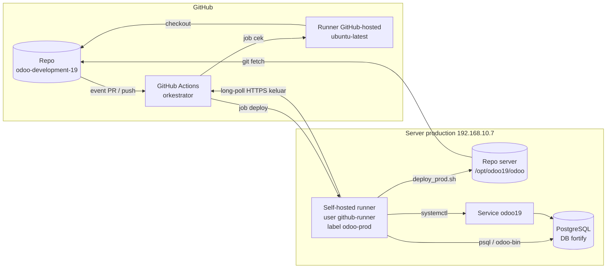
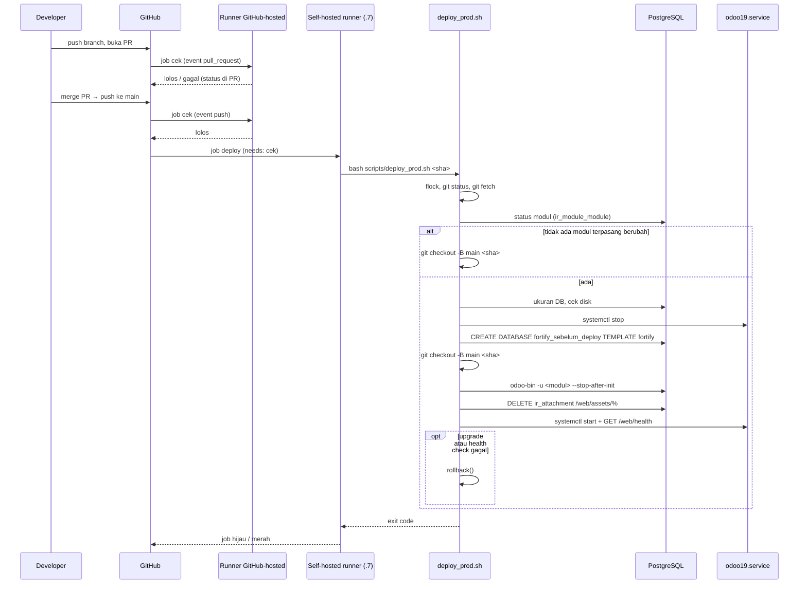

# CI/CD Odoo 19 — Referensi Teknis

Dokumen ini adalah referensi teknis: cara kerja internal, file dan fungsi yang menjalankan setiap langkah, kapan dijalankan, oleh siapa, dengan hak apa, dan apa akibatnya bila gagal.

Untuk alur kerja harian tim (cara membuat PR, membaca hasil, menangani rollback), lihat [ci_cd.md](ci_cd.md). Nomor baris di dokumen ini mengacu ke versi file saat dokumen ditulis. Bila file berubah, cari nama fungsi atau judul bagiannya.

---

## Daftar isi

1. [Arsitektur](#1-arsitektur)
2. [Inventaris file](#2-inventaris-file)
3. [Pemicu: kapan apa dijalankan](#3-pemicu-kapan-apa-dijalankan)
4. [Workflow `.github/workflows/ci-cd.yml`](#4-workflow-githubworkflowsci-cdyml)
5. [CI: `scripts/ci/cek_modul.py`](#5-ci-scriptscicek_modulpy)
6. [CD: `scripts/deploy_prod.sh`](#6-cd-scriptsdeploy_prodsh)
7. [Model hak akses dan keamanan](#7-model-hak-akses-dan-keamanan)
8. [State: di mana "versi yang berjalan" disimpan](#8-state-di-mana-versi-yang-berjalan-disimpan)
9. [Artefak yang dibuat di server](#9-artefak-yang-dibuat-di-server)
10. [Matriks kegagalan](#10-matriks-kegagalan)
11. [Konfigurasi dan cara mengubahnya](#11-konfigurasi-dan-cara-mengubahnya)
12. [Menguji pipeline](#12-menguji-pipeline)
13. [Batasan yang diketahui](#13-batasan-yang-diketahui)
14. [Glosarium](#14-glosarium)

---

## 1. Arsitektur

### 1.1 Komponen



| Komponen | Di mana | Dijalankan sebagai | Peran |
|---|---|---|---|
| GitHub Actions | GitHub | — | Menerima event repo, membaca workflow, membagi job ke runner |
| Runner GitHub-hosted | VM Ubuntu sekali pakai milik GitHub | user `runner` di VM itu | Menjalankan job `cek`. Tidak punya akses ke server |
| Self-hosted runner | Server .7, service systemd `actions.runner.*` | user OS `github-runner` | Menjalankan job `deploy`. Hanya membuka koneksi **keluar** (long-poll HTTPS ke GitHub), tidak ada port masuk |
| Repo server | `/opt/odoo19/odoo` | dimiliki `odoo19` | Kode yang dipakai service. Berisi juga core Odoo (`odoo-bin`, `odoo/`, `addons/`) yang di-ignore git |
| Service Odoo | `odoo19.service` | `odoo19` | Odoo production, config `/etc/odoo19.conf`, venv `/opt/odoo19/venv` (Python 3.11) |
| PostgreSQL | lokal, data di `/var/lib/postgresql` | role `odoo19` (peer auth) | DB `fortify` |

### 1.2 Urutan lengkap satu perubahan



---

## 2. Inventaris file

| File | Bahasa | Dijalankan di | Dipanggil oleh | Fungsi |
|---|---|---|---|---|
| [.github/workflows/ci-cd.yml](../.github/workflows/ci-cd.yml) | YAML (GitHub Actions) | GitHub | Event `pull_request` / `push` | Definisi pemicu, job, urutan, dan runner |
| [scripts/ci/cek_modul.py](../scripts/ci/cek_modul.py) | Python 3 (+ lxml) | Runner GitHub-hosted, atau laptop | Job `cek`, atau manual | Pemeriksaan statis semua modul |
| [scripts/cek_owl_xml.py](../scripts/cek_owl_xml.py) | Python 3 | (diimpor) | `cek_modul.py` | Dua aturan template Owl. Sudah ada sebelum CI/CD dan juga bisa dipakai mandiri |
| [scripts/deploy_prod.sh](../scripts/deploy_prod.sh) | Bash | Self-hosted runner di .7 | Job `deploy`, atau manual (uji kering) | Seluruh deploy dan rollback |
| [docs/ci_cd.md](ci_cd.md) | Markdown | — | — | Panduan alur kerja tim |
| `docs/ci_cd_teknis.md` | Markdown | — | — | Dokumen ini |

File yang **tidak** termasuk pipeline: `scripts/deploy_demo.sh` dan `scripts/jalankan_tes_flex.sh` adalah alat manual untuk server development 192.168.10.10. Lihat [ci_cd.md §9.8](ci_cd.md#98-deploy_demosh-dan-jalankan_tes_flexsh).

---

## 3. Pemicu: kapan apa dijalankan

### 3.1 Matriks event

| Peristiwa di GitHub | `github.event_name` | Job `cek` | Job `deploy` | Base pembanding cek versi |
|---|---|---|---|---|
| PR ke `main` dibuka | `pull_request` (`opened`) | ✅ | ❌ | `origin/main` |
| Push commit baru ke branch PR | `pull_request` (`synchronize`) | ✅, run lama dibatalkan | ❌ | `origin/main` |
| PR dibuka ulang | `pull_request` (`reopened`) | ✅ | ❌ | `origin/main` |
| PR di-merge | `push` ke `main` | ✅ | ✅ bila `cek` lolos | `github.event.before` (SHA `main` sebelum merge) |
| Push langsung ke `main` | `push` | ✅ | ✅ bila `cek` lolos | `github.event.before` |
| Push ke branch lain tanpa PR | — | ❌ | ❌ | — |
| PR ke branch selain `main` | — | ❌ | ❌ | — |
| "Re-run jobs" di tab Actions | sama dengan event aslinya | ✅ | ✅ (event `push`) | sama dengan aslinya |

`pull_request` tanpa `types` memakai bawaan GitHub, yaitu `opened`, `synchronize`, dan `reopened`. Menutup PR tanpa merge tidak memicu apa pun.

### 3.2 Concurrency (antrean)

| Grup | Anggota | `cancel-in-progress` | Perilaku |
|---|---|---|---|
| `cek-refs/pull/<n>/merge` | run `cek` untuk satu PR | `true` | Push baru ke PR membatalkan run `cek` yang sedang jalan untuk PR itu |
| `cek-refs/heads/main` | run `cek` pada `main` | `false` | Satu berjalan, maksimal satu menunggu |
| `deploy-production` | semua job `deploy` | `false` | Satu berjalan, maksimal satu menunggu |

Aturan GitHub untuk grup concurrency: bila sudah ada satu job **menunggu** dan job baru masuk, job yang menunggu **dibatalkan** dan digantikan yang baru, walaupun `cancel-in-progress: false`. Untuk deploy hal ini aman, karena `deploy_prod.sh` selalu menghitung selisih dari versi yang sedang berjalan (HEAD server) sampai target. Perubahan dari merge yang dilewati ikut ter-deploy.

### 3.3 Batas waktu

| Batas | Nilai | Di mana diatur | Akibat bila terlampaui |
|---|---|---|---|
| Job `cek` | 10 menit | `timeout-minutes` di workflow | Job gagal → deploy tidak jalan |
| Job `deploy` | 45 menit | `timeout-minutes` di workflow | GitHub menghentikan runner step. **Rollback tidak dijalankan** (lihat [§13](#13-batasan-yang-diketahui)) |
| Upgrade `odoo-bin` | 1800 detik | `BATAS_UPGRADE` di skrip | `timeout` membunuh proses (exit 124) → rollback |
| Menunggu service berhenti | 30 detik | `layanan_stop()` | Deploy batal, service dinyalakan lagi |
| Menunggu koneksi DB habis | 20 detik | loop di bagian 5 skrip | Lanjut mencoba salin. Bila gagal → batal, service dinyalakan lagi |
| Health check | 60 × (≤5 detik + 2 detik) | `layanan_start_dan_cek()` | Rollback |
| Job menunggu runner | 24 jam (aturan GitHub) | — | Job dibatalkan |

---

## 4. Workflow `.github/workflows/ci-cd.yml`

### 4.1 Tingkat atas

| Kunci | Nilai | Arti |
|---|---|---|
| `name` | `CI/CD` | Nama workflow di tab Actions |
| `on.pull_request.branches` | `[main]` | Hanya PR yang menuju `main` |
| `on.push.branches` | `[main]` | Hanya push ke `main` |
| `permissions.contents` | `read` | `GITHUB_TOKEN` hanya bisa membaca repo. Workflow tidak bisa push, membuat release, atau mengubah PR |

Workflow ini tidak memakai **secret** apa pun. Akses ke server tidak lewat GitHub, karena runner sudah berada di dalam server.

### 4.2 Job `cek`

| Langkah | Isi | Catatan |
|---|---|---|
| `runs-on: ubuntu-latest` | VM baru dari GitHub | Memakai kuota menit Actions |
| `actions/checkout@v4`, `fetch-depth: 0` | Clone dengan riwayat penuh | Diperlukan supaya `git diff BASE...HEAD` dan `git show BASE:<file>` bisa jalan |
| `actions/setup-python@v5`, `3.11` | Python sama dengan venv production | Sintaks yang hanya valid di 3.12+ gagal di sini, seperti juga akan gagal di production |
| `pip install lxml==4.9.3` | Pustaka XML yang dipakai Odoo | Versi `requirements.txt` untuk Python 3.11 |
| Periksa | `python scripts/ci/cek_modul.py [--base $BASE]` | Exit ≠ 0 → job merah |

Ekspresi `BASE`:

```yaml
BASE: ${{ github.event_name == 'pull_request' && format('origin/{0}', github.base_ref) || github.event.before }}
```

- Pada PR: `origin/main`.
- Pada push: SHA `main` sebelum push (`github.event.before`).
- Skrip shell mengecek dulu apakah `BASE` adalah commit yang ada (`git rev-parse -q --verify`). Bila tidak (misalnya `0000…` atau riwayat yang ditulis ulang), cek versi dilewati dan pemeriksaan lain tetap jalan.

### 4.3 Job `deploy`

| Kunci | Nilai | Arti |
|---|---|---|
| `needs: cek` | | Hanya mulai bila `cek` sukses. Di GitHub Free untuk repo private, inilah **satu-satunya gerbang otomatis** sebelum production |
| `if` | `push` **dan** `refs/heads/main` | Job PR tidak pernah sampai ke server |
| `runs-on` | `[self-hosted, odoo-prod]` | Hanya runner yang punya **kedua** label. Label `odoo-prod` hanya boleh dipasang di .7 |
| `timeout-minutes` | 45 | Lihat [§3.3](#33-batas-waktu) |
| `concurrency` | `deploy-production` | Lihat [§3.2](#32-concurrency-antrean) |
| `actions/checkout@v4`, `fetch-depth: 1` | | Clone dangkal ke folder kerja runner (`~github-runner/actions-runner/_work/...`), **bukan** ke `/opt/odoo19/odoo` |
| Deploy | `ODOO_DB=fortify bash scripts/deploy_prod.sh "${{ github.sha }}"` | Skrip diambil dari commit yang di-deploy. Perubahan pada skrip berlaku mulai deploy yang membawanya |

---

## 5. CI: `scripts/ci/cek_modul.py`

### 5.1 Antarmuka

```
python scripts/ci/cek_modul.py [--base REF]
```

| | |
|---|---|
| Input | Folder kerja repo (ditemukan relatif dari lokasi skrip, `AKAR`). Opsional `--base REF` untuk cek versi |
| Output | Baris anotasi GitHub (`::error file=...,line=...::pesan` / `::warning ...`) dan ringkasan `N modul diperiksa, M kesalahan.` |
| Exit code | `0` tidak ada kesalahan (peringatan boleh ada), `1` ada ≥1 kesalahan |
| Dependensi | Python ≥3.8, `lxml`, `git` (hanya untuk `--base`), `scripts/cek_owl_xml.py` |
| Waktu | ±4 detik untuk 72 modul |

### 5.2 Konstanta

| Nama | Nilai | Arti |
|---|---|---|
| `AKAR` | dua tingkat di atas file skrip | Root repo |
| `FOLDER_ADDONS` | `fortress_addons`, `nativ_addons`, `ohrms_addons` | Folder yang dipindai. **Harus sama** dengan `FOLDER_ADDONS` di `deploy_prod.sh` |
| `DILEWATI` | `__pycache__`, `node_modules`, `.git`, `docs` | Subfolder yang tidak dipindai. `docs/` dilewati karena tidak dimuat Odoo dan bisa berisi arsip XML yang memang tidak valid |

### 5.3 Fungsi

| Fungsi | Masukan → keluaran | Yang dilakukan |
|---|---|---|
| `main()` | argv → exit code | Untuk setiap modul: `cek_manifest()` + `cek_berkas()`. Bila `--base`: `cek_kenaikan_versi()`. Cetak ringkasan |
| `daftar_modul()` | → generator `(folder, nama, path)` | Setiap subfolder di `FOLDER_ADDONS` yang berisi `__manifest__.py`, terurut nama |
| `cek_manifest(path_modul)` | → jumlah kesalahan | `ast.literal_eval` isi manifest (aman, tidak mengeksekusi kode). Harus dict, punya `name` dan `version`, dan `version` diawali `19.0.` |
| `cek_berkas(path_modul)` | → jumlah kesalahan | `os.walk` seluruh modul kecuali `DILEWATI`. `.py`: `compile(..., 'exec')` untuk menangkap `SyntaxError` (kode tidak dijalankan). `.xml`: `lxml.etree.parse`. `.xml` di bawah `static/`: `cek_owl_xml.teks_antar_cabang()` dan `cek_owl_xml.xpath_menyasar_akar(path, {})` |
| `cek_kenaikan_versi(base)` | → hanya mencetak peringatan | `git diff --name-only BASE...HEAD` (tiga titik = perubahan sejak titik percabangan). Ambil `<folder>/<modul>`, bandingkan `version` di `BASE` dengan versi sekarang. Sama → `::warning`. Modul baru dan manifest yang tak terbaca dilewati |
| `anotasi(jenis, path, pesan, baris)` | → cetak | Format anotasi GitHub dengan path relatif repo |
| `git(*args)` | → stdout | `subprocess.run(['git', '-C', AKAR, ...])` dengan `encoding='utf-8'`, `check=True` |
| `baca_manifest(teks)` | → objek | Pembungkus `ast.literal_eval` |

### 5.4 Fungsi dari `scripts/cek_owl_xml.py` yang dipakai

| Fungsi | Mendeteksi |
|---|---|
| `teks_antar_cabang(path)` | Teks bermakna di antara elemen `t-if` / `t-elif` / `t-else`, yang di browser hanya muncul sebagai "An error occured in the owl lifecycle" |
| `xpath_menyasar_akar(path, peta_induk)` | `xpath position="before/after"` yang menyasar elemen akar template induk, sehingga template punya dua simpul teratas. Dipanggil dengan `peta_induk = {}`, sehingga hanya template induk di file yang sama yang bisa dinilai |

### 5.5 Batas pemeriksaan

Semua pemeriksaan bersifat **statis**. Odoo tidak dijalankan. Akibatnya yang **tidak** tertangkap:
- `NameError` / import yang salah saat modul dimuat;
- field atau model di view yang tidak ada;
- `ref` / xml_id yang salah;
- CSV hak akses yang merujuk model tidak ada;
- tes unit.

Kesalahan semacam itu baru muncul di langkah upgrade `deploy_prod.sh` dan memicu rollback.

---

## 6. CD: `scripts/deploy_prod.sh`

### 6.1 Antarmuka

```
[ODOO_DB=fortify] [DEPLOY_DRY_RUN=1] bash scripts/deploy_prod.sh <sha_target>
```

| Argumen / env | Wajib | Bawaan | Arti |
|---|---|---|---|
| `$1` | ya | — | SHA commit target. Boleh pendek, karena di-resolve dengan `git rev-parse --verify` |
| `ODOO_DB` | tidak | `fortify` | Nama DB production |
| `DEPLOY_DRY_RUN` | tidak | `0` | `1` = berhenti setelah mencetak rencana, tanpa perubahan apa pun |

Opsi shell: `set -uo pipefail`. Variabel tak terdefinisi menjadi error, dan pipeline gagal bila salah satu bagiannya gagal. **Tidak** memakai `set -e`, sehingga setiap kegagalan ditangani eksplisit dengan `||` / `if`.

### 6.2 Exit code

| Kode | Arti | Keadaan production |
|---|---|---|
| `0` | Sukses; atau tidak ada yang perlu dikerjakan (sudah di target / target lebih tua); atau dry run | Di target, atau tidak berubah |
| `1` | Gagal. Bisa terjadi sebelum ada perubahan (validasi, disk, stop service, cadangan), atau setelah rollback berhasil | **Seperti sebelum deploy** |
| `2` | Kunci dipegang deploy lain | Tidak disentuh |
| `3` | Rollback DB gagal | **Tidak pasti. Perlu tindakan manual segera** |

Di job GitHub, semua kode ≠ 0 membuat job berwarna merah.

### 6.3 Konfigurasi (variabel di kepala skrip)

| Variabel | Nilai | Dipakai untuk |
|---|---|---|
| `REPO` | `/opt/odoo19/odoo` | Semua perintah git (`g`) |
| `PY` | `/opt/odoo19/venv/bin/python3` | Menjalankan `odoo-bin` |
| `ODOO_BIN` | `$REPO/odoo-bin` | Upgrade |
| `CONF` | `/etc/odoo19.conf` | Upgrade (addons_path, kredensial DB, dll.) |
| `SVC` | `odoo19` | `systemctl` |
| `OS_USER` | `odoo19` | Pemilik repo, filestore, dan role Postgres |
| `URL_SEHAT` | `http://127.0.0.1:8069/web/health` | Health check (endpoint bawaan Odoo, membalas `{"status": "pass"}`) |
| `FOLDER_ADDONS` | `fortress_addons nativ_addons ohrms_addons` | Deteksi modul berubah |
| `WAKTU` | `YYYYMMDD_HHMMSS` saat skrip mulai | Nama log dan nama DB gagal |
| `CADANGAN` | `${DB}_sebelum_deploy` | Nama DB cadangan |
| `LOGDIR` / `LOG` | `/tmp/deploy_prod` / `upgrade_$WAKTU.log` | Log `odoo-bin` |
| `KUNCI` | `/tmp/.deploy_prod.lock` | `flock` |
| `BATAS_UPGRADE` | `1800` | Detik untuk `timeout` upgrade |
| `PG_MOUNT` | `/var/lib/postgresql` | Path yang diukur `df` |
| `DISK_SISA_MIN_GB` | `10` | Sisa disk minimal setelah salinan DB dibuat |

### 6.4 Fungsi pembantu

| Fungsi | Isi | Catatan |
|---|---|---|
| `judul "teks"` | Cetak `=== teks ===` | Penanda bagian di log job |
| `gagal "teks"` | Cetak `::error::teks` | Muncul merah di ringkasan job. **Tidak** menghentikan skrip; penghentian selalu eksplisit dengan `exit` |
| `peringatan "teks"` | Cetak `::warning::teks` | Muncul kuning |
| `sebagai_odoo cmd…` | Bila user sekarang `odoo19`: jalankan langsung. Bila tidak: `sudo -n -u odoo19 cmd…` | `-n` = non-interaktif. Bila sudoers belum benar, perintah langsung gagal, bukan menggantung menunggu password |
| `g args…` | `sebagai_odoo git -C $REPO args…` | Semua operasi git sebagai pemilik repo, supaya kepemilikan file `.git` tidak rusak |
| `sql "query" [db]` | `sebagai_odoo psql -X -v ON_ERROR_STOP=1 -d ${db:-postgres} -tAc "query"` | `-X` mengabaikan `.psqlrc`, `-tA` keluaran polos tanpa header. DB bawaan `postgres` untuk perintah tingkat cluster (CREATE/DROP/RENAME DATABASE) |
| `layanan_stop` | `sudo -n systemctl stop odoo19`, lalu tunggu `is-active` false, maks. 30 × 1 detik | Return 1 bila tidak mau berhenti |
| `layanan_start_dan_cek` | `sudo -n systemctl start odoo19`, lalu `curl -fsS --max-time 5 URL_SEHAT` sampai sukses, maks. 60 kali dengan jeda 2 detik | Return 1 bila tidak sehat |
| `rollback` | Lihat [§6.6](#66-rollback) | Didefinisikan **setelah** cadangan dibuat, sehingga hanya bisa dipanggil bila cadangan sudah ada |

### 6.5 Langkah demi langkah

Nomor bagian sesuai penanda `# ── N.` di skrip. Tanda **[aman]** berarti sampai titik itu production belum diubah sama sekali.

#### Bagian 1 — Kunci (baris ±101) **[aman]**

```bash
exec 9>/tmp/.deploy_prod.lock
flock -n 9 || exit 2
```

Kunci file pada file descriptor 9 dipegang selama proses hidup dan lepas otomatis saat proses selesai atau mati. `-n` berarti tidak menunggu. Lapisan ini melengkapi `concurrency` GitHub, dan juga menjaga dari uji kering atau deploy manual yang berjalan bersamaan.

#### Bagian 2 — Rencana (baris ±109–180) **[aman]**

| Urutan | Perintah | Tujuan / kondisi berhenti |
|---|---|---|
| 1 | `LAMA=$(g rev-parse HEAD)` | SHA yang sedang berjalan |
| 2 | `g status --porcelain --untracked-files=no` | Tidak kosong → **exit 1**. Melindungi perubahan yang diedit langsung di server. File untracked (misalnya modul yang belum masuk repo) diabaikan |
| 3 | `g fetch -q origin main` | Gagal → exit 1 (kredensial atau jaringan) |
| 4 | `g rev-parse --verify "$TARGET^{commit}"` | SHA harus ada setelah fetch |
| 5 | `g merge-base --is-ancestor TARGET origin/main` | Target harus bagian dari `main`. Mencegah deploy commit dari branch lain |
| 6 | `LAMA == TARGET` | **exit 0**, sudah di target |
| 7 | `is-ancestor LAMA origin/main`? | Tidak → `::warning`, server di luar `main` dan akan dikembalikan ke `main` |
| 8 | (bila 7 ya) `is-ancestor TARGET LAMA`? | Ya → **exit 0**, target lebih tua, mencegah downgrade lewat "Re-run" |
| 9 | `BERUBAH=$(g diff --name-only LAMA TARGET)` | Diff **dua titik** = perbedaan isi pohon antara versi berjalan dan target, termasuk semua merge di antaranya |
| 10 | Deteksi modul (lihat bawah) | → `MODUL_BERUBAH` |
| 11 | `sql "SELECT 1" $DB` | Gagal → exit 1. Mencegah query gagal dibaca sebagai "belum terpasang" |
| 12 | Per modul: `SELECT state FROM ir_module_module WHERE name='<m>'` | `installed` → `TERPASANG` (dipisah koma). Lainnya → `BELUM` (dilewati). Query gagal → exit 1 |
| 13 | `requirements.txt` ada di `BERUBAH`? | `::warning`, tidak memasang apa pun |
| 14 | `DEPLOY_DRY_RUN=1`? | **exit 0** setelah mencetak rencana |

Algoritme deteksi modul (langkah 10):

```bash
echo "$BERUBAH" | awk -F/ -v f=" fortress_addons nativ_addons ohrms_addons " \
    'NF>=3 && index(f, " "$1" ") {print $2}' | sort -u
```

- Ambil path dengan minimal 3 komponen (`folder/modul/file`) yang komponen pertamanya salah satu `FOLDER_ADDONS`. Cetak komponen kedua (nama modul), lalu buang duplikat.
- Saring lagi: modul hanya dihitung bila `TARGET:<folder>/<modul>/__manifest__.py` ada (`git cat-file -e`). Modul yang dihapus di target tidak di-upgrade.

Contoh:

| Path berubah | Hasil |
|---|---|
| `fortress_addons/fortress_crm/models/crm_lead.py` | `fortress_crm` |
| `fortress_addons/fortress_crm/docs/alur.md` | `fortress_crm` (ikut, walaupun hanya dokumen) |
| `fortress_addons/README.md` | diabaikan (hanya 2 komponen) |
| `scripts/deploy_prod.sh`, `docs/ci_cd.md`, `.github/...` | diabaikan |
| `requirements.txt` | diabaikan + peringatan |

#### Bagian 3 — Tanpa modul terpasang yang berubah (baris ±181–187)

```bash
g checkout -q -B main "$TARGET"   # lalu exit 0
```

`checkout -B main <sha>` membuat atau memindahkan branch lokal `main` ke SHA target dan memperbarui working tree. Service **tidak** di-restart. Ini juga jalur deploy pertama untuk PR CI/CD itu sendiri.

Bila ada modul yang berubah tapi belum terpasang: kodenya ikut ter-update, tidak ada yang dipasang, dan tidak ada restart.

#### Bagian 3b — Cek disk (baris ±189–206) **[aman]**

```
UKURAN_DB   = pg_database_size('fortify')
UKURAN_LAMA = ukuran fortify_sebelum_deploy (0 bila belum ada)
SISA        = df --output=avail -B1 /var/lib/postgresql
PERLU       = UKURAN_DB − UKURAN_LAMA + DISK_SISA_MIN_GB × 2^30
```

- Ketiga angka harus numerik. Bila tidak (query atau `df` gagal) → exit 1.
- `SISA < PERLU` → exit 1, **sebelum** service dihentikan, jadi tanpa downtime.
- Ada DB `fortify_gagal_%` → `::warning` beserta daftarnya.

Contoh dengan angka 16-11-2026: DB 2.527 MB, sisa 26 GB → perlu ±12 GB → lanjut.

#### Bagian 4 — Hentikan layanan (baris ±208–214)

`layanan_stop`. Gagal → `systemctl start` lalu exit 1. **Downtime dimulai di sini.**

#### Bagian 5 — Cadangan (baris ±216–235)

1. Tunggu `count(*) FROM pg_stat_activity WHERE datname='fortify'` menjadi 0, maks. 20 detik. Koneksi worker (±23) tertutup beberapa detik setelah service berhenti. Skrip **tidak** memutus paksa koneksi siapa pun.
2. `DROP DATABASE IF EXISTS "fortify_sebelum_deploy"`
3. `CREATE DATABASE "fortify_sebelum_deploy" WITH TEMPLATE "fortify"`. Postgres menyalin berkas data DB secara utuh, lebih cepat dari `pg_dump`/`pg_restore`, dan konsisten karena tidak ada koneksi.
4. Gagal (biasanya masih ada koneksi lain) → cetak daftar koneksi, nyalakan service, exit 1. **Kode belum diubah.**
5. Cetak lama penyalinan: `cadangan siap: DB N MB disalin dalam S detik`.

Mulai titik ini fungsi `rollback` tersedia.

#### Bagian 6 — Kode (baris ±250–253)

`g checkout -q -B main "$TARGET"`. Gagal (misalnya ada file untracked yang akan tertimpa oleh file baru di target) → rollback, exit 1.

#### Bagian 7 — Upgrade (baris ±255–271)

```bash
sudo -n -u odoo19 timeout 1800 /opt/odoo19/venv/bin/python3 /opt/odoo19/odoo/odoo-bin \
    -c /etc/odoo19.conf -d fortify -u <modul1,modul2> \
    --stop-after-init --no-http --logfile=/tmp/deploy_prod/upgrade_<WAKTU>.log
```

| Opsi | Arti |
|---|---|
| `-u a,b` | Upgrade modul-modul ini. Odoo juga ikut memuat ulang modul yang bergantung padanya bila diperlukan |
| `--stop-after-init` | Keluar setelah registry selesai dimuat |
| `--no-http` | Tidak membuka port. Aman berjalan walaupun ada proses lain di port 8069 |
| `--logfile` | Log lengkap ke file, tidak ke log service |

Keputusan:
- Baris log ` ERROR ` / ` CRITICAL ` (maks. 20 terakhir) ditampilkan sebagai `::warning`.
- **Rollback** bila exit ≠ 0 (termasuk 124 karena `timeout`) **atau** ada baris ` CRITICAL `. Potongan log (`-A15` dari setiap ERROR/CRITICAL/Traceback, 60 baris terakhir) dicetak dulu.
- `ERROR` saja tidak memicu rollback, karena Odoo kadang mencatat ERROR yang tidak fatal saat upgrade.

#### Bagian 8 — Buang cache aset (baris ±273–275)

```sql
DELETE FROM ir_attachment WHERE url LIKE '/web/assets/%';
```

Dijalankan **selama service masih mati**. Bila dilakukan saat 5 worker hidup, semua worker berebut membangun ulang bundle yang sama, menghasilkan attachment ganda, dan browser pengguna diminta refresh berkali-kali (lihat kepala `scripts/deploy_demo.sh`). Bundle dibangun ulang sekali oleh permintaan pertama setelah service menyala.

#### Bagian 9 — Nyalakan (baris ±277–284)

`layanan_start_dan_cek`. Gagal → 60 baris terakhir `journalctl -u odoo19` dicetak, lalu rollback, exit 1. Sukses → **downtime berakhir**, cetak ringkasan, exit 0.

### 6.6 Rollback

```bash
rollback() {
    systemctl is-active --quiet odoo19 && layanan_stop
    g checkout -q -B main "$LAMA"
    ALTER DATABASE "fortify" RENAME TO "fortify_gagal_<WAKTU>"
    ALTER DATABASE "fortify_sebelum_deploy" RENAME TO "fortify"     # hanya bila rename pertama sukses
    layanan_start_dan_cek
}
```

| Sifat | Penjelasan |
|---|---|
| Cepat | Rename DB adalah operasi katalog, hampir instan, berapa pun ukuran DB |
| Tidak kehilangan data | Service sudah mati sejak sebelum salinan dibuat, jadi tidak ada transaksi pengguna di antaranya |
| DB gagal disimpan | `fortify_gagal_<WAKTU>` untuk diperiksa, lalu dihapus manual |
| Filestore tidak dikembalikan | Berkas attachment baru dari upgrade yang gagal tetap ada di filestore tetapi tidak dirujuk DB. Tidak berbahaya |
| Rename gagal | `::error ROLLBACK DB GAGAL`, **exit 3**. Service tetap mati. Perlu tindakan manual: cek `\l` di psql, pastikan ada DB bernama `fortify` |

### 6.7 Perkiraan waktu satu deploy (DB 2,5 GB)

| Fase | Perkiraan | Service |
|---|---|---|
| Rencana (fetch, query) | 2–5 detik | hidup |
| Cek disk | <1 detik | hidup |
| Stop + menunggu koneksi | 2–10 detik | **mati** |
| Salin DB | 15–25 detik | **mati** |
| Upgrade | 20 detik – beberapa menit, tergantung modul | **mati** |
| Buang cache + start + health check | 10–30 detik | **mati** → hidup |

---

## 7. Model hak akses dan keamanan

### 7.1 Siapa menjalankan apa

| Perintah | Dijalankan sebagai | Mekanisme |
|---|---|---|
| Runner, checkout workflow, `bash deploy_prod.sh` | `github-runner` | Service runner |
| `git …` di `/opt/odoo19/odoo` | `odoo19` | `sudo -n -u odoo19` |
| `psql …` | `odoo19` (role Postgres `odoo19`, peer auth) | `sudo -n -u odoo19` |
| `odoo-bin -u …` | `odoo19` | `sudo -n -u odoo19` |
| `systemctl stop/start odoo19` | `root` | `sudo -n` (perintah tertentu saja) |
| `systemctl is-active` | `github-runner` | tanpa sudo |
| `journalctl -u odoo19` | `root` | `sudo -n` (gagal diam-diam bila tidak diizinkan) |
| `curl` health check | `github-runner` | tanpa sudo |
| `df` | `github-runner` | tanpa sudo |

Aturan sudoers yang dibutuhkan (`/etc/sudoers.d/github-runner`):

```
github-runner ALL=(odoo19) NOPASSWD: ALL
github-runner ALL=(root) NOPASSWD: /usr/bin/systemctl stop odoo19, /usr/bin/systemctl start odoo19, /usr/bin/journalctl -u odoo19 *
```

Role Postgres `odoo19` harus punya `CREATEDB` dan menjadi pemilik DB `fortify` (untuk `CREATE DATABASE … TEMPLATE` dan `ALTER DATABASE … RENAME`).

### 7.2 Batas kepercayaan

- **Siapa pun yang bisa push ke `main` bisa menjalankan kode sebagai `odoo19` di production**, karena workflow dan skrip diambil dari commit yang di-push. Di GitHub Free (repo private) ini tidak bisa dibatasi dengan branch protection. Batasi hak *write* repo hanya untuk developer inti.
- Job PR tidak pernah berjalan di self-hosted runner (`if: push && main`). Tetapi PR bisa **mengubah workflow**, dan perubahan itu baru berlaku setelah merge ke `main`. Karena itu review perubahan pada `.github/` dan `scripts/deploy_prod.sh` harus ekstra teliti.
- Tidak ada secret di GitHub. Kredensial git server (deploy key / token milik `odoo19`) tetap berada di server.
- `GITHUB_TOKEN` hanya `contents: read`.
- Runner hanya membuat koneksi keluar. Tidak ada port SSH atau port lain yang dibuka ke internet.

---

## 8. State: di mana "versi yang berjalan" disimpan

Tidak ada berkas status terpisah. Sumber kebenarannya:

| Pertanyaan | Sumber |
|---|---|
| Kode apa yang berjalan? | `HEAD` (= branch lokal `main`) di `/opt/odoo19/odoo` |
| Versi modul di DB? | `ir_module_module.latest_version` |
| Deploy terakhir sukses? | Tab Actions, atau `git -C /opt/odoo19/odoo log -1` |
| Kondisi DB sebelum deploy terakhir? | `fortify_sebelum_deploy` (hanya dari deploy terakhir yang meng-upgrade modul) |

Invarian yang dijaga skrip:
- Setelah exit 0 dengan perubahan: `HEAD = TARGET`.
- Setelah rollback: `HEAD = LAMA`, dan DB `fortify` = cadangan.
- Setelah exit 1 sebelum bagian 6: `HEAD` dan DB tidak berubah.

Karena state = HEAD server, **perubahan manual pada repo server mengganggu perhitungan modul berubah**:
- `git pull` atau `checkout` manual membuat deploy berikutnya menghitung selisih dari titik yang salah, sehingga modul yang kodenya sudah berubah bisa tidak di-upgrade.
- Edit file langsung membuat deploy berikutnya menolak berjalan.

---

## 9. Artefak yang dibuat di server

| Artefak | Dibuat oleh | Umur | Pembersihan |
|---|---|---|---|
| `/tmp/.deploy_prod.lock` | bagian 1 | permanen (kosong) | tidak perlu |
| `/tmp/deploy_prod/upgrade_<WAKTU>.log` | bagian 7 | sampai reboot / pembersihan `/tmp` | otomatis oleh OS |
| DB `fortify_sebelum_deploy` | bagian 5 | sampai deploy berikutnya yang meng-upgrade modul | ditimpa otomatis |
| DB `fortify_gagal_<WAKTU>` | rollback | permanen | **manual**: `sudo -u odoo19 dropdb fortify_gagal_<WAKTU>` |
| Branch lokal `main` di repo server | bagian 3 / 6 | — | — |
| Objek git baru di `.git` | `git fetch` | permanen | `git gc` sesekali (opsional) |
| Folder kerja runner `~github-runner/actions-runner/_work/` | `actions/checkout` | ditimpa setiap job | otomatis |

---

## 10. Matriks kegagalan

| Titik gagal | Pesan di log | Exit | Kode | DB | Service | Tindakan |
|---|---|---|---|---|---|---|
| Kunci dipegang | `Ada deploy lain yang sedang berjalan` | 2 | tetap | tetap | hidup | Tunggu, lalu re-run |
| Repo server kotor | `Ada perubahan lokal yang belum di-commit` | 1 | tetap | tetap | hidup | Bereskan repo server ([ci_cd.md §10](ci_cd.md#10-troubleshooting)) |
| Fetch gagal | `git fetch gagal` | 1 | tetap | tetap | hidup | Periksa kredensial / jaringan `odoo19` |
| SHA bukan bagian `main` | `bukan bagian dari origin/main` | 1 | tetap | tetap | hidup | — |
| DB tidak terjangkau | `Tidak bisa terhubung ke database` | 1 | tetap | tetap | hidup | Periksa Postgres / sudoers |
| Pengukuran gagal | `Gagal mengukur DB/disk` | 1 | tetap | tetap | hidup | Periksa `PG_MOUNT` |
| Disk kurang | `Disk tidak cukup untuk cadangan DB` | 1 | tetap | tetap | hidup | Kosongkan disk, re-run |
| Service tidak berhenti | `Layanan odoo19 tidak mau berhenti` | 1 | tetap | tetap | dinyalakan lagi | Periksa journal |
| Salin DB gagal | `Cadangan gagal (masih ada koneksi lain…)` | 1 | tetap | tetap | dinyalakan lagi | Tutup koneksi yang tercantum, re-run |
| Checkout gagal (jalur tanpa restart) | `git checkout gagal` | 1 | tetap | tetap | hidup | Periksa file untracked yang bentrok |
| Checkout gagal (jalur upgrade) | `git checkout gagal` + ROLLBACK | 1 | LAMA | cadangan | hidup | Sama |
| Upgrade gagal / timeout | `Upgrade gagal. Potongan log:` + ROLLBACK | 1 | LAMA | cadangan | hidup | Perbaiki lewat PR |
| Health check gagal | `Layanan tidak sehat setelah upgrade` + ROLLBACK | 1 | LAMA | cadangan | hidup | Lihat journal di log |
| Rename DB gagal saat rollback | `ROLLBACK DB GAGAL — tangani manual!` | 3 | LAMA | **tidak pasti** | **mati** | **Darurat**, manual |
| Tidak sehat setelah rollback | `Layanan tidak sehat bahkan setelah rollback` | 1 | LAMA | cadangan | **bermasalah** | Darurat, periksa server |
| Job melewati 45 menit | (job dihentikan GitHub) | — | tidak pasti | tidak pasti | tidak pasti | Periksa manual ([§13](#13-batasan-yang-diketahui)) |

"tetap" = tidak berubah dari sebelum deploy. "LAMA" = SHA sebelum deploy. "cadangan" = isi DB persis sebelum deploy.

---

## 11. Konfigurasi dan cara mengubahnya

| Kebutuhan | Yang diubah |
|---|---|
| Ganti nama DB production | `ODOO_DB` di step deploy workflow (dan bawaan di skrip bila perlu) |
| Path repo / venv / config / service berbeda (misalnya server baru) | Variabel `REPO`, `PY`, `CONF`, `SVC`, `OS_USER` di skrip. Bila banyak server, jadikan env di workflow |
| Port Odoo berbeda | `URL_SEHAT` |
| Tambah folder addons baru | `FOLDER_ADDONS` di **kedua** file: `deploy_prod.sh` (string dipisah spasi) dan `cek_modul.py` (tuple). Tambahkan juga di `addons_path` `/etc/odoo19.conf` |
| Ambang disk | `DISK_SISA_MIN_GB` |
| Batas waktu upgrade | `BATAS_UPGRADE` (skrip) dan `timeout-minutes` job deploy. Pastikan yang kedua lebih besar |
| Versi Python production berubah | `python-version` dan pin `lxml` di job `cek` |
| Menambah server (staging) | Runner baru dengan label lain, job baru di workflow dengan `runs-on: [self-hosted, <label>]` |
| Menonaktifkan sementara | Actions → CI/CD → Disable workflow, atau hentikan service runner ([ci_cd.md §9.6](ci_cd.md#96-menghentikan-deploy-sementara)) |

---

## 12. Menguji pipeline

| Apa | Perintah | Mengubah sesuatu? |
|---|---|---|
| CI di laptop | `python scripts/ci/cek_modul.py --base origin/main` | Tidak |
| Pastikan CI menangkap error | Buat file `.py`/`.xml` rusak di salah satu modul, jalankan cek, harus exit 1, lalu hapus filenya | Tidak (file sementara) |
| Sintaks skrip deploy | `bash -n scripts/deploy_prod.sh` | Tidak |
| Rencana deploy di server | `sudo -u github-runner env DEPLOY_DRY_RUN=1 bash <clone>/scripts/deploy_prod.sh <sha>` | Hanya `git fetch` (objek di `.git`) |
| Hak sudo runner | `sudo -u github-runner sudo -n -u odoo19 true && echo ok` | Tidak |
| Health check | `curl -fsS http://127.0.0.1:8069/web/health` | Tidak |
| Deploy nyata tanpa restart | Merge PR yang tidak mengubah modul terpasang | Hanya HEAD repo server |

---

## 13. Batasan yang diketahui

| Batasan | Dampak | Mitigasi / rencana |
|---|---|---|
| CI tidak menjalankan Odoo | Error tingkat Odoo baru tertangkap saat deploy (lalu rollback) | Tes di runner staging ([ci_cd.md §12](ci_cd.md#12-batasan-dan-rencana-ke-depan)) |
| Job dibunuh GitHub di menit 45 (atau runner mati di tengah deploy) | Skrip berhenti tanpa sempat rollback. Service bisa mati, DB bisa setengah ter-upgrade | `BATAS_UPGRADE` (30 menit) dibuat lebih kecil dari batas job. Bila terjadi, pulihkan manual: rename `fortify_sebelum_deploy` → `fortify`, checkout SHA lama, start service |
| Modul yang berubah di-upgrade walaupun perubahannya hanya dokumen di folder modul | Downtime yang sebenarnya tidak perlu | Bisa ditambah penyaring path (`docs/`, `*.md`) bila mengganggu |
| Perubahan core Odoo (di-ignore git) tidak di-deploy | Pembaruan core tetap manual | — |
| `requirements.txt` tidak dipasang otomatis | Upgrade gagal dengan ImportError → rollback | Pasang paket sebelum merge |
| Modul baru tidak dipasang otomatis | Disengaja | Pasang lewat Apps |
| Rollback tidak mengembalikan filestore | Berkas yatim di filestore | Tidak berbahaya |
| Salinan DB memakan waktu yang tumbuh seiring ukuran DB | Downtime bertambah | Pantau baris `cadangan siap: … detik`. Opsi lanjutan dibahas di percakapan desain: jendela deploy, rilis via staging |
| Satu cadangan saja | Tidak bisa kembali ke kondisi 2 deploy sebelumnya | Ini bukan backup. Backup rutin terpisah tetap wajib |
| Tidak ada notifikasi | Tim harus melihat tab Actions | Rencana: notifikasi ke grup chat |

---

## 14. Glosarium

| Istilah | Arti |
|---|---|
| **Workflow** | Berkas YAML di `.github/workflows/` yang mendefinisikan kapan dan apa yang dijalankan GitHub Actions |
| **Job** | Sekumpulan langkah dalam workflow yang berjalan di satu runner (`cek`, `deploy`) |
| **Step** | Satu perintah atau action di dalam job |
| **Runner** | Program agen yang mengambil job dari GitHub dan menjalankannya di mesinnya |
| **GitHub-hosted runner** | Runner di VM milik GitHub, dibuat baru setiap job |
| **Self-hosted runner** | Runner yang kita pasang sendiri, di sini di server .7 |
| **Label runner** | Penanda runner (`self-hosted`, `odoo-prod`) yang dicocokkan dengan `runs-on` |
| **`needs`** | Ketergantungan antar job: job menunggu job lain sukses |
| **Concurrency group** | Nama antrean. Job dalam grup yang sama tidak berjalan bersamaan |
| **Anotasi** | Baris `::error::` / `::warning::` yang ditampilkan GitHub sebagai pesan berwarna, dan di tab "Files changed" bila menyertakan `file=` |
| **SHA** | ID unik commit git |
| **HEAD** | Commit yang sedang di-checkout di sebuah repo |
| **Ancestor** | Commit A adalah ancestor B bila A ada dalam riwayat B (B "lebih baru" atau sama) |
| **Diff dua titik / tiga titik** | `A B` = perbedaan isi antara A dan B; `A...B` = perubahan di B sejak titik percabangan dengan A |
| **Dry run** | Menjalankan skrip hanya sampai mencetak rencana |
| **Rollback** | Mengembalikan kode dan DB ke keadaan sebelum deploy |
| **Template DB** | `CREATE DATABASE x TEMPLATE y` = membuat DB baru sebagai salinan berkas DB lain |
| **flock** | Kunci berkas Linux untuk mencegah dua proses berjalan bersamaan |
